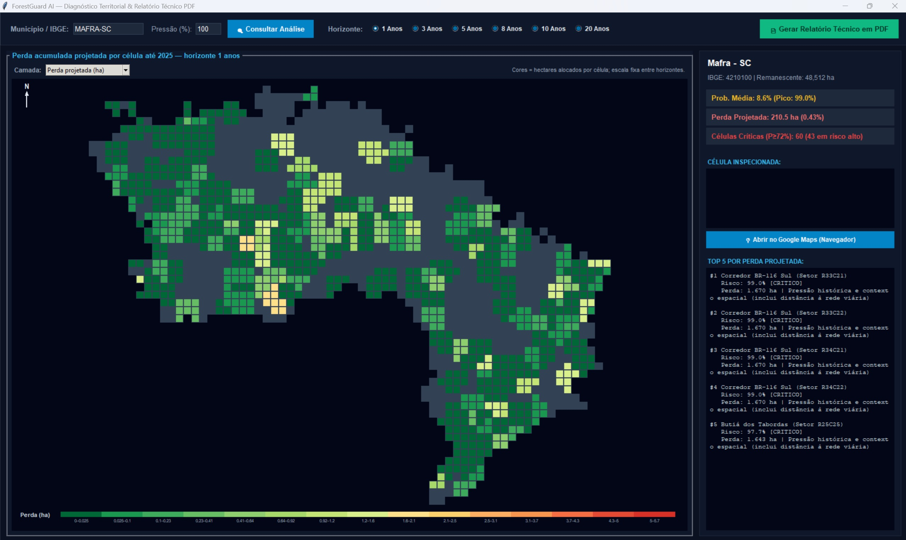

<p align="center">
  <picture>
    <source media="(prefers-color-scheme: dark)" srcset="public/logo_sctecB.png">
    <source media="(prefers-color-scheme: light)" srcset="public/logo_sctecW.png">
    
  </picture>
</p>

# ForestGuard AI v27.1

Sistema de apoio à decisão para estimar o risco relativo de supressão de vegetação em horizonte anual, combinando previsão de ML com Regressão Ridge + XGBoost, API REST em FastAPI e interface desktop.

> Aviso importante: os escores produzidos pelo sistema são de risco relativo e priorização territorial. Eles não representam desmatamento consumado, auto de infração, nem probabilidade calibrada para uso jurídico isolado.

---

<p align="center">
  <video src="public/ForestGuard_AI_Video.mp4" width="700" poster="public/ForestGuard_Capa.png" controls>
    Seu navegador não suporta a reprodução de vídeos.
  </video>
</p>

---

## Visão geral

O ForestGuard foi pensado para apoiar órgãos ambientais, equipes técnicas e gestores públicos na priorização de áreas para investigação e fiscalização, quando a capacidade operacional é limitada.

O projeto combina:

- painel espacial por célula (dados municipais e de vizinhança);
- predição de ML com Regressão Ridge + XGBoost para priorização de risco e projeções temporais;
- classificador anual para `y_loss_1y` (perda de floresta de t0 para t0+1), com XGBoost como modelo principal;
- regressão Ridge para projeções temporais e avaliação de confiabilidade em séries históricas (`projection_core.py` e `reliability.py`);
- API de inferência com baixa latência e modelo em memória;
- geração de relatório PDF e dashboard para comunicação técnica;
- interface desktop para uso local e demonstração operacional.

Essa combinação é uma prática bastante desafiadora na área de ML, porque integra modelos com diferentes comportamentos, requisitos de regularização e objetivos de previsão em uma mesma solução analítica.

Município de referência no pacote: Mafra/SC — IBGE `4210100`.

---

## Problema de negócio

Em cenários de fiscalização e monitoramento territorial, nem sempre é possível inspecionar todo o território. O desafio é decidir onde olhar primeiro.

O ForestGuard busca responder essa pergunta por meio de um ranking espacial de risco relativo, permitindo focar esforço humano e recursos em áreas com maior chance de perda de cobertura vegetal no horizonte de 1 ano.

---

## Origem do modelo

Este projeto foi desenvolvido dentro do contexto do edital SCTEC como solução de análise preditiva espacial, com pipeline próprio e validação controlada para evitar vazamento de futuro.

O modelo principal para priorização espacial é um XGBoost (`binary:logistic`) aplicado ao alvo `y_loss_1y`. Em paralelo, o projeto também incorpora uma Regressão Ridge em componentes de projeção temporal e validação de confiabilidade, com foco em séries históricas municipais e benchmarking de desempenho.

| Item | Detalhe |
|------|---------|
| Alvo principal | `y_loss_1y` (variável binária de perda florestal em 1 ano) |
| Algoritmo principal | XGBoost (`binary:logistic`) |
| Modelo complementar | Regressão Ridge (regularização L2) em `projection_core.py` e `reliability.py` |
| Dados | Painel espacial municipal com features de vizinhança, relevo, pressão antrópica e atributos territoriais |
| Validação | Holdout temporal + walk-forward com embargo |
| Artefato | `data/spatial/models/4210100_annual/spatial_model.json` + `spatial_model_meta.json` |

Resumo do desempenho em holdout 2020:

| Métrica | Valor |
|---------|------:|
| ROC-AUC | ~0,85 |
| PR-AUC | ~0,59 |
| Recall@top 10% | ~0,64 |

Esses valores indicam bom poder de ordenação do risco, e não uma probabilidade calibrada para previsão pontual ou uso jurídico isolado.

---

## Stack tecnológica

| Camada | Tecnologias |
|--------|-------------|
| API | FastAPI, Uvicorn, Pydantic v2 |
| ML | XGBoost, scikit-learn, NumPy, Regressão Ridge |
| Relatórios | ReportLab, Pillow |
| Geoprocessamento | Shapely, PyProj |
| Desktop | Tkinter, tkintermapview |
| Empacotamento | `requirements.txt`, caminhos relativos |

Arquitetura da API:

```text
src/supressao_vegetacao/api/
  main.py        → ponto de entrada e lifespan
  schemas.py     → contratos Pydantic
  services.py    → carregamento do modelo e inferência
  routers.py     → APIRouter (/health, /predict)
  app.py         → FastAPI, rotas de negócio, cache e dashboard
  model_cache.py → modelo e análises em memória
```

---

## Requisitos

- Python 3.10+ (recomendado 3.11/3.12)
- Ambiente virtual recomendado
- Dependências listadas em `requirements.txt`

---

## Fontes e extração de dados

O projeto usa três fluxos distintos. MapBiomas e PRODES alimentam séries municipais de cobertura/perda florestal; o notebook do Google Earth Engine (GEE) gera painéis anuais por célula para treinar o modelo espacial. O notebook GEE usa MapBiomas como uma de suas fontes, mas não consulta PRODES.

### MapBiomas: série municipal agregada

O catálogo local é construído a partir da planilha MapBiomas Coleção 11 `MAPBIOMAS_BRAZIL-COL.11-BIOME_STATE_MUNICIPALITY.xlsx`, que deve estar em `data/mapbiomas/`. O código não baixa essa planilha automaticamente.

A rotina `rebuild_index_from_xlsx()` soma, por código IBGE, as linhas da classe `1. Forest` para os anos disponíveis de 2015 a 2024. A diferença positiva entre anos consecutivos é registrada como perda anual aproximada; o último valor da série é usado como remanescente. O índice resultante fica em `data/mapbiomas/forest_by_municipality.json` e é lido pelo catálogo em tempo de execução. Essa série é uma agregação da planilha, não uma extração de pixels feita pelo aplicativo.

>https://brasil.mapbiomas.org/downloads/estatisticas/

### PRODES: consulta ao TerraBrasilis/INPE

Para obter a série PRODES por município, `scripts/add_city.py` consulta as camadas WFS `yearly_deforestation` do TerraBrasilis/INPE para os biomas atendidos pelo código (Mata Atlântica, Amazônia Legal, Cerrado e Pantanal). A consulta usa a caixa envolvente da malha municipal IBGE e pagina os resultados; depois, seleciona os polígonos cujo centroide cai dentro do limite municipal, converte `area_km` para hectares e soma por ano. Por isso, a atribuição municipal é feita pelo centroide — não pelo recorte/interseção exata da geometria na divisa.

Ao adicionar um município, o script salva a malha em `data/boundaries/{ibge}.geojson`, gera por padrão a série de 2018 a 2024 e grava os resultados em `data/prodes_{municipio}_{uf}.json` e no cache `data/mapbiomas/cache/{ibge}_prodes.json`. Se não houver valor de remanescente informado, o código também pode estimá-lo pelas camadas PRODES `residual`, aplicando a mesma regra de centroide.

```bash
python scripts/add_city.py NOME-UF
```


### Google Earth Engine: painéis espaciais por célula

O processo está em [`scripts/gee/export_municipality_panel.ipynb`](scripts/gee/export_municipality_panel.ipynb) e foi preparado para execução no Google Colab. O notebook autentica e inicializa a API do Earth Engine, obtém a geometria municipal via `geobr`/IBGE e cria uma grade de células de 1 km no CRS `EPSG:32722`. A configuração atual seleciona Mafra (`4210100`) e os anos de 2000 a 2020.

Para cada ano, o notebook lê a banda anual de classificação do asset MapBiomas Coleção 9, considera floresta as classes `3`, `4`, `5`, `6` e `49` e agrega a fração de floresta por célula. Também deriva atributos estáticos de elevação e declividade do SRTM e, quando válido para o ano, superfície construída do GHSL. O rótulo anual de perda é construído comparando a fração florestal entre anos consecutivos, sujeito ao limite mínimo de pixels válidos configurado no notebook. Esses painéis não são séries PRODES.

O notebook exporta uma tabela CSV por município e ano para a pasta `ForestGuard_Panels_v22` no Google Drive. É necessário usar uma conta/projeto com acesso ao Earth Engine, autenticar, aguardar a conclusão das tarefas de exportação e executar as etapas de validação e empacotamento do próprio notebook antes de usar os arquivos em `data/spatial/panels/{ibge}/` para treinamento.

> Atenção à versão da fonte: o notebook GEE usa MapBiomas Coleção 9 para formar os painéis; o índice municipal local descrito acima usa a planilha da Coleção 11.

---

## Instalação e execução

### 1) Criar o ambiente virtual

```bash
# Linux / macOS
python3 -m venv .venv
source .venv/bin/activate
pip install -r requirements.txt

# Windows (PowerShell)
python -m venv .venv
.\.venv\Scripts\activate
pip install -r requirements.txt
```

### 2) Definir o `PYTHONPATH`

```bash
# Linux / macOS
export PYTHONPATH=src

# Windows (PowerShell)
$env:PYTHONPATH="src"
```

### 3) Treinar ou atualizar o modelo espacial (opcional)

```bash
python scripts/train_spatial.py \
  --panel data/spatial/panels/4210100 \
  --target y_loss_1y \
  --model-dir data/spatial/models/4210100_annual
```

Artefatos esperados:

- `data/spatial/models/4210100_annual/spatial_model.json`
- `data/spatial/models/4210100_annual/spatial_model_meta.json`

### 4) Iniciar a API

```bash
python scripts/run_api.py
```

Também é possível executar manualmente com Uvicorn:

```bash
uvicorn supressao_vegetacao.api.main:app --host 0.0.0.0 --port 8080
```

Endpoints úteis:

- Swagger: http://127.0.0.1:8080/docs
- Health: http://127.0.0.1:8080/health

No startup, o modelo e as análises dos horizontes 1–20 podem ser pré-carregados em memória.

### 5) Interface desktop

O script `scripts/run_desktop.py` inicia a interface gráfica local do ForestGuard AI. Ele adiciona automaticamente a pasta `src` ao caminho de importação do Python; por isso, não é necessário configurar `PYTHONPATH` para iniciar o desktop. A API também não precisa estar em execução.

Com o ambiente virtual ativado e as dependências instaladas, execute o comando a partir da raiz do repositório:

```bash
python scripts/run_desktop.py
```

Por padrão, a aplicação abre a análise de Mafra/SC (`4210100`) para o alvo anual `y_loss_1y`. Informe o nome ou o código IBGE de um município e clique em **Consultar Análise** para gerar a visualização. A interface permite explorar o mapa e as métricas por horizonte, alternar entre risco espacial e perda projetada e exportar um relatório técnico em PDF.

O desktop requer um ambiente com suporte a interface gráfica. Em ambientes Linux sem Tkinter ou sem servidor gráfico, o aplicativo tenta iniciar um modo interativo pelo terminal, que também permite gerar o relatório em PDF.

<p align="center">
  <picture>
    
  </picture>
</p>

---

## Documentação da API

### Endpoints principais

| Método | Rota | Função |
|--------|------|--------|
| `GET` | `/health` | Verifica saúde do serviço e se o modelo está em RAM |
| `POST` | `/v1/predict` | Inferência espacial em ranking de células |
| `POST` | `/predict` | Alias do endpoint principal exigido pelo edital |
| `GET` | `/v1/analyze/{ibge}/pdf` | Gera relatório PDF |
| `POST` | `/v1/simulate/annual` | Simulação agregada anual |
| `GET` | `/v1/dashboard/{ibge}` | Retorna payload do dashboard |
| `GET` | `/v1/dashboard/{ibge}/view` | Renderiza dashboard em HTML |

Documentação interativa: http://127.0.0.1:8080/docs

### Exemplo: `POST /v1/predict`

Request:

```http
POST /v1/predict
Content-Type: application/json
```

```json
{
  "ibge_code": "4210100",
  "years": 1,
  "top_n": 20,
  "target": "y_loss_1y"
}
```

Campos principais:

| Campo | Tipo | Restrições |
|-------|------|------------|
| `ibge_code` | string | 7 dígitos (`4210100`) |
| `years` | int | 1–20 |
| `top_n` | int | 1–500 |
| `target` | string | `y_loss_1y` |

cURL:

```bash
curl -s -X POST "http://127.0.0.1:8080/v1/predict" \
  -H "Content-Type: application/json" \
  -d '{"ibge_code":"4210100","years":1,"top_n":10}'
```

Se o payload for inválido (por exemplo `years: 99`), a API responde com `HTTP 422`.

### Exemplo: `GET /health`

```bash
curl -s http://127.0.0.1:8080/health
```

Resposta esperada: `HTTP 200` com status de serviço ativo e indicação se o modelo está carregado em memória.

---

## Variáveis de ambiente

Algumas rotinas e scripts usam variáveis de ambiente locais para facilitar execução e pré-carregamento.

Exemplo:

```bash
# Município de referência para demo
export DEFAULT_DEMO_IBGE=4210100

# Pré-carregar modelos em memória no startup da API
export FORESTGUARD_PRELOAD_IBGE=4210100
```
---

## Estrutura do repositório

```text
.
├── .env.example
├── .gitignore
├── README.md
├── VERSION
├── requirements.txt
├── assets/                         # Logos adicionais
├── public/                         # Logos e materiais visuais do projeto
├── data/
│   ├── api_artifacts/4210100/      # Relatórios e resultados da API
│   ├── boundaries/                 # Limites municipais em GeoJSON
│   ├── mapbiomas/
│   │   ├── cache/                  # Séries PRODES em cache por município
│   │   ├── forest_by_municipality.json
│   │   └── MAPBIOMAS_BRAZIL-COL.11-BIOME_STATE_MUNICIPALITY.xlsx
│   ├── roads/                      # Malha viária municipal
│   ├── spatial/
│   │   ├── models/                 # Modelos e metadados treinados
│   │   └── panels/                 # Painéis anuais por município
│   └── prodes_mafra_sc.json        # Série PRODES de referência
├── scripts/
│   ├── gee/
│   │   └── export_municipality_panel.ipynb
│   ├── add_city.py
│   ├── run_api.py
│   ├── run_desktop.py
│   ├── train_all_city_models.py
│   ├── train_spatial.py
│   └── verify_annual.py
└── src/
    └── supressao_vegetacao/
        ├── api/                    # API FastAPI, rotas, serviços e cache
        ├── desktop/                # Interface Tkinter e geração de PDF
        ├── inference/              # Inferência e treinamento
        ├── sources/                # Fontes, catálogo MapBiomas e dados PRODES
        ├── spatial/                # Painéis, modelos e inferência espacial
        ├── projection_core.py      # Projeções temporais
        ├── reliability.py          # Confiabilidade das projeções
        ├── settings.py             # Configurações e horizontes
        └── validation.py           # Validações
```

Não utilize caminhos absolutos do tipo `C:\Users\...` em comandos de execução do projeto.

---

## Link do vídeo / apresentação

>[Video apresentação do projeto](https://drive.google.com/file/d/1vh0vJdTtg4tgpi5uYS-XpC25rIVJvM84/view?usp=sharing)

---

## Estória do projeto

Certa noite, enquanto trabalhava, minha filha de oito anos me perguntou: “o que tanto você digitava e trabalhava no computador?”. Tentei explicar de várias formas, mas ela sempre me olhava com a mesma expressão de quem não entendeu nada.

Então resolvi criar uma história em quadrinhos. Mostrei para ela e, para minha surpresa, ela disse: “Está fazendo um mapinha para não cortar mais árvores, né pai”.

Foi uma forma simples e ingênua de resumir a ideia central do projeto, e por isso decidi compartilhar.

<p align="center">
  <picture>
    
  </picture>
</p>

Mafra-SC, 22 de outubro de 2026.